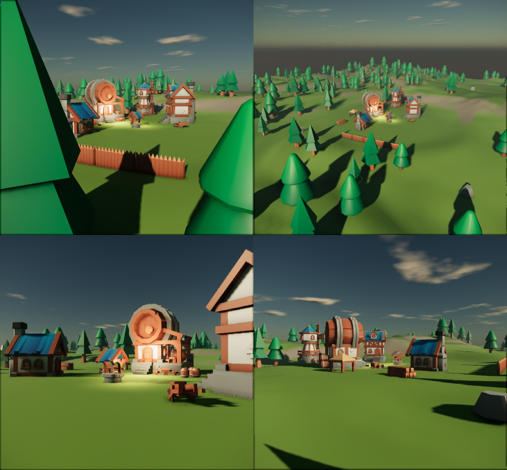

# GameDeveloperSkill

Skill multi-host (Claude Code, Kilo, Codex, Cursor...) che porta un'idea a una **vertical slice giocabile e curata**, di qualsiasi genere e stile: intervista GDD approfondita, poi worker isolati che girano **tutti insieme** (scheduler a ondate, sempre continuo), ognuno chiuso da prove su disco (lint, test, screenshot con voto).

**L'engine lo sceglie l'utente** (prima domanda del GDD); la skill si adatta con lo stesso contratto a 8 verbi (ping, build, lint, shot, test, play, lock, package):

| Engine | Ponte | Layer deterministico |
|---|---|---|
| Unity 6 URP | Unity CLI (`unity command gds_*`) | C# GDS: mondi procedurali, blueprint, villaggi, lint, lookdev, personaggi, VFX |
| **Nucleon** | `scripts/ncli.py` → MCP integrato dell'editor (HTTP o stdio, batch JSON-RPC, PNG su disco, lock) | `ncli build` da spec JSON, `ncli lint`, test Lua in Play (`templates/nucleon`), `html2rml.py` per la UI RmlUi |
| Unreal 5.8 | MCP ufficiale Epic | `gds_ue.py`, Megascans/Fab, Landscape + PCG |
| Godot 4 | headless (+ addon MCP se presente) | minimo |



*Nucleon, fatta interamente dalla skill da JSON: `nc_world.py` (terreno + scatter), `ncli build` (villaggio dal kit catalog), `nc_world.py look`, `ncli lint --play` (0 problemi). Bug dell'engine trovati: [docs/NUCLEON-ENGINE-NOTES.md](docs/NUCLEON-ENGINE-NOTES.md).*

## Skill aggiuntiva: `fivem-sollumz/`

Pipeline Blender + Sollumz per modelli GTA V / FiveM (prop statici, fisici, animati con YCD, UV, DUI, porte, luci,
Gen8 + Gen9), 100% pilotabile da Python. Vedi [fivem-sollumz/README.md](fivem-sollumz/README.md).

## Avvio

```bat
install.bat            :: rileva host e tool, installa la skill una volta e la collega a ogni host
update.bat             :: git pull + reinstalla con host e moduli salvati (anche game-developer\scripts\update.bat)
start-dashboard.bat    :: console: progetto, FabCLI, DesignerSkill
```

Poi nel client: `/game <idea>` (o `/gdd`, `/playtest`, `/resumegame` dopo un crollo).

## Cosa c'è dentro

```
game-developer/
  SKILL.md                 orchestratore (parent)
  references/              un file per fase/tema, letto on demand
  templates/Editor/GDS/    layer C# deterministico (World, LevelBuilder, Village, PB, SceneLint, LookDev, Shots, ...) + comandi CLI
  templates/Runtime/GDS/   runtime: Noise, VoxelWorld (chunk, greedy meshing, scava/costruisci), SkyGradient shader
  templates/world/         spec di esempio: terrain, island, dungeon, cave, voxel
  templates/blender/       generatore procedurale di edifici
  templates/unreal/        gds_ue.py (lookdev, lint, screenshot, import Fab, heightmap)
  templates/nucleon/       harness test Lua (gds_test.lua, test_move.lua), spec di esempio
  templates/*.md|json      DECISIONI, TESTER_README, feel-baseline, progress-checkpoint, worker-report, gate, gate-plan
  scripts/                 doctor, install GDS nel progetto, fetch kit/audio CC0, edifici Blender headless,
                           gate_link.py (contratto con game-launch-strategist), design_review.py (schermate/orfani, run a tempi),
                           ncli.py (ponte Nucleon), html2rml.py (mock HTML → RmlUi)
  command/                 /game /gdd /playtest /resumegame
  tools/tui/               console
docs/                      audit, roadmap, sample render
```

## Pipeline

`/game` → **Q0 engine (scelta dell'utente)** → intervista (blocchi A-E, domande adattive) → (controllo di mercato offerto) → project → task (60-80, per deliverable) → greybox + test → kit → **world-gen** → edifici/livelli → hero prop → lookdev → **art review a punteggio** → personaggi → sistemi (verbo = script + test) → feel baseline (scena vera) → UI (varianti di tutte le schermate in parallelo, una sola domanda all'utente) → baseline di qualità → juice → art review → playtest → slice.

Dopo il greybox i track ART / CODE / UI / AUDIO / QUALITY girano in parallelo; l'editor ha un solo driver alla volta (lock).

Dopo la slice: **design review** (mappa del gioco dal codice, mappa schermate con controllo orfani, run simulate a tempi) → piano dei gate → **gate di iterazione** con header leggibile da macchina → review "dopo". Con `game-launch-strategist` le due skill si passano il lavoro con file fissi (`references/launch-link.md`, contratto `gdl-v3`); senza, la skill lavora da sola.

## Documentazione

- `INSTALL.md` — installazione e setup
- `docs/AUDIT-2026-09.md` — perché la pipeline è fatta così (con fonti)
- `docs/ROADMAP.md` — idee non ancora fatte
